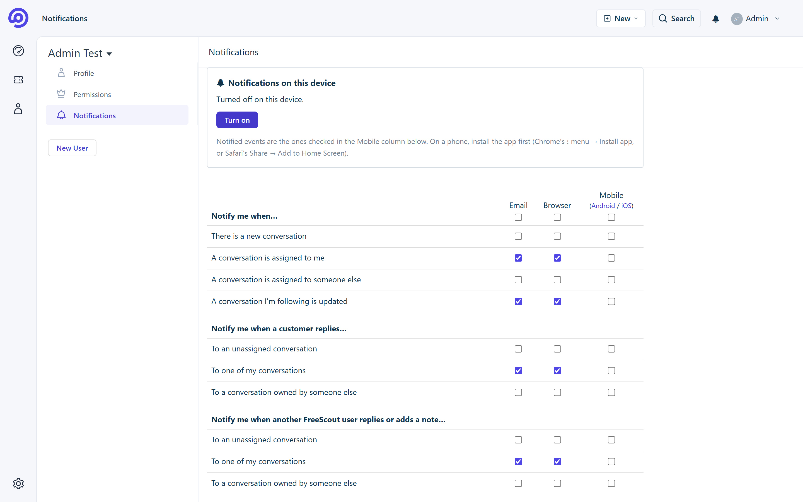
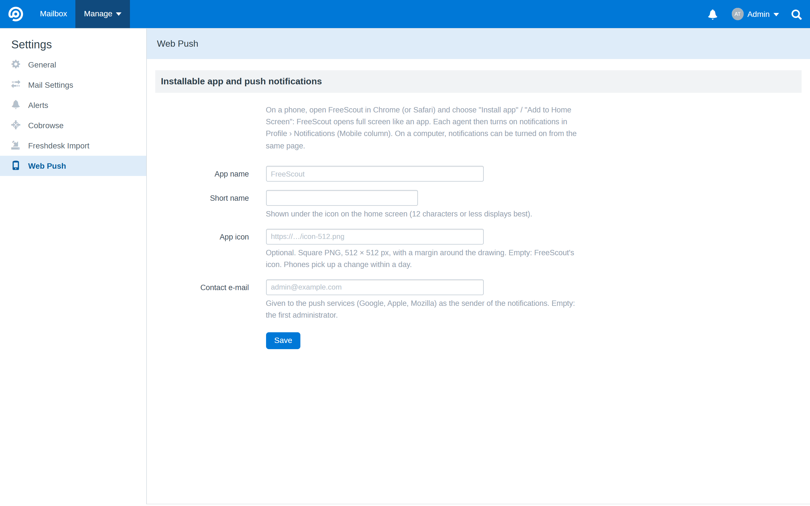
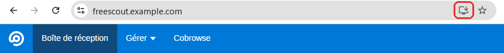

# Web Push for FreeScout — install FreeScout as an app

**This module lets your agents install [FreeScout](https://freescout.net) as an app, right from their browser**, on
their phone or computer: no app store, nothing to download. FreeScout then opens in its own window, with its own icon
on the home screen, the taskbar or the dock, like any other app.

And it **notifies them of new tickets and replies, even when FreeScout is closed**, like a mobile app would.

→ [How to install the app](#install-freescout-as-an-app), once the module is activated.

*For the technically minded:* FreeScout becomes a Progressive Web App (PWA), and notifications are sent with the Web
Push standard, through the browser's own push service. No third-party relay: notifications are encrypted end to end
and only the subscribed device can read them.

> Built as part of [Refresh](https://github.com/altmenorg/freescout-refresh), a new interface for FreeScout inspired by Freshdesk. Works with or without it.

## Features

- **Installable app (PWA)**: on a phone, *Install app* (Chrome) or *Add to Home Screen* (Safari) opens FreeScout full
  screen, with its own name and icon. Desktop browsers can install it too.
- **Web Push notifications** on phones and desktops, delivered by the browser's own push service (Google, Mozilla,
  Apple) even when the app and the browser are closed.
- **FreeScout's own notification settings**: each agent picks the events in the *Mobile* column of
  **Profile › Notifications** (the column is enabled by the module). The first device of an agent starts with the same
  events as their *Email* column.
- **End-to-end encryption**: pure PHP implementation of VAPID (RFC 8292) and aes128gcm content encryption
  (RFC 8291 / 8188), with OpenSSL. No Composer dependency, no external service.
- One notification per ticket: a new event replaces the previous notification of the same ticket. Tapping it opens the
  ticket.
- **"Notifications on this device"** box in Profile › Notifications: turn on, turn off, send a test.
- In the installed app, a one-time prompt offers to turn notifications on.
- English and French.

## Requirements

- FreeScout 1.8 or newer, PHP 7.3+ with the `openssl` and `curl` extensions.
- **HTTPS** (browsers require it for installable apps and push notifications).
- iPhone / iPad: iOS 16.4 or newer, and the app must be added to the Home Screen (Apple only allows Web Push there).

## Installation

1. Download [`WebPush.zip`](https://github.com/altmenorg/freescout-webpush/releases/latest/download/WebPush.zip) from the latest release and unzip it into the `Modules` folder of FreeScout: you get `Modules/WebPush`
   (the folder **must** have this name).
2. In FreeScout, **Manage › Modules**: activate **Web Push**.
3. Optional: **Manage › Settings › Web Push** to set the app name and icon.
4. Each agent: [install the app](#install-freescout-as-an-app) on their phone or computer, then
   **Profile › Notifications** › *Turn on*, and tick the events of the *Mobile* column.

**Coming from Refresh 1.2 or older** (this feature used to be part of it): update Refresh to 1.3 or newer and install
this module. Its settings, server keys and device subscriptions are taken over automatically: subscribed devices keep
receiving notifications without doing anything.

**Updates:** from version 1.0.1, FreeScout tells you in **Manage › Modules** when a new version is out, and the **Update** button installs it in one click. From an older version, update once by hand as above.

## Install FreeScout as an app

Log in to FreeScout first, in the browser of the device, then:

**Android — Chrome**

1. Tap the **⋮** menu at the top right.
2. Tap **Install app** (on some phones: *Add to Home screen* › *Install*).
3. Confirm. The FreeScout icon appears on the home screen and in the app drawer.

**iPhone / iPad — Safari** (iOS 16.4 or newer)

1. Tap the **Share** button (the square with an arrow).
2. Tap **Add to Home Screen**, then **Add**.
3. Open FreeScout **from its new icon**: on iPhone, notifications only work in the app added to the Home Screen, not in
   Safari itself.

**Windows, macOS, Linux — Chrome or Edge**

1. Click the **install icon** at the right end of the address bar (a small screen with a down arrow).
   If you don't see it: **⋮** menu › **Cast, save and share** › **Install** (Chrome), or **…** menu › **Apps** ›
   **Install this site as an app** (Edge).
2. Click **Install**. FreeScout opens in its own window, and can be pinned to the taskbar or the dock.

**Firefox** can install web apps on Android only: on a computer, use Chrome or Edge to install the app.
(Notifications themselves work in Firefox on a computer too, without installing anything.)

Once the app is installed, it offers once to turn notifications on; this can also be done any time from
**Profile › Notifications** › *Notifications on this device*.

## Settings

**Manage › Settings › Web Push**

| Setting | |
|---|---|
| **App name / Short name** | Name of the installable app, and the one shown under its icon. |
| **App icon** | Square PNG, 512 px recommended. Empty: FreeScout's icons. |
| **Contact e-mail** | Given to the push services as the sender of the notifications. Empty: the first administrator. |

The server keys are created on first use in `storage/app/webpush/`, next to the list of subscribed devices. Keep this
folder when moving servers: new keys would silently cut every existing subscription.

## For module developers

Everything the module adds is prefixed `webpush` (routes, options, CSS classes, storage, translations). On every page
of a logged-in agent, `window.webpush` exposes three promise-returning functions: `current()` (the device's push
subscription, or `null`), `enable()` and `disable()`. The profile box and the prompt use the `webpush-*` classes and can
be restyled.

## Other modules from the Refresh project

This module was built as part of [Refresh](https://github.com/altmenorg/freescout-refresh), a new interface for FreeScout. The modules of the project, all usable on their own:

- **[Refresh](https://github.com/altmenorg/freescout-refresh)**: a new, Freshdesk-inspired interface for FreeScout: views, SLA badges, dashboard, properties panel, phone version.
- **[Cobrowse](https://github.com/altmenorg/freescout-cobrowse)**: co-browse with your customers (Cobrowse.io) from the ticket sidebar, to guide them on your website or app.
- **[Freshdesk Import](https://github.com/altmenorg/freescout-freshdesk-import)**: import your Freshdesk tickets into FreeScout and keep them in sync until you switch over.
- **[Claude Assistant](https://github.com/altmenorg/freescout-claude-assistant)**: draft and improve replies with Claude, from the reply editor.

## License

[AGPL-3.0](LICENSE), like FreeScout.
